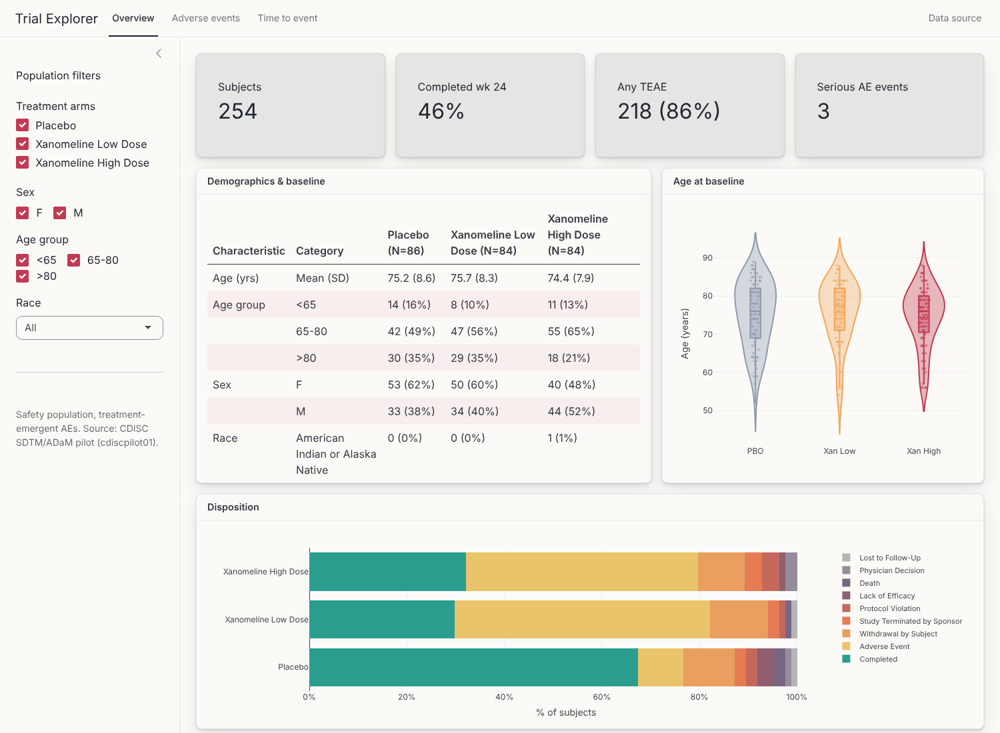
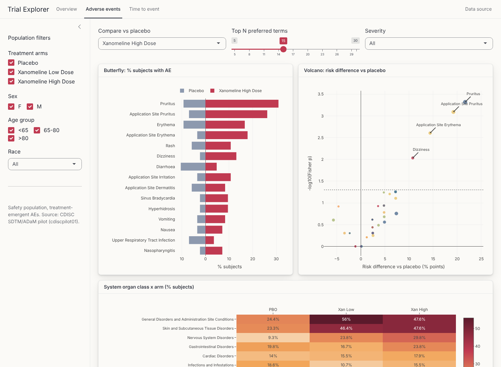
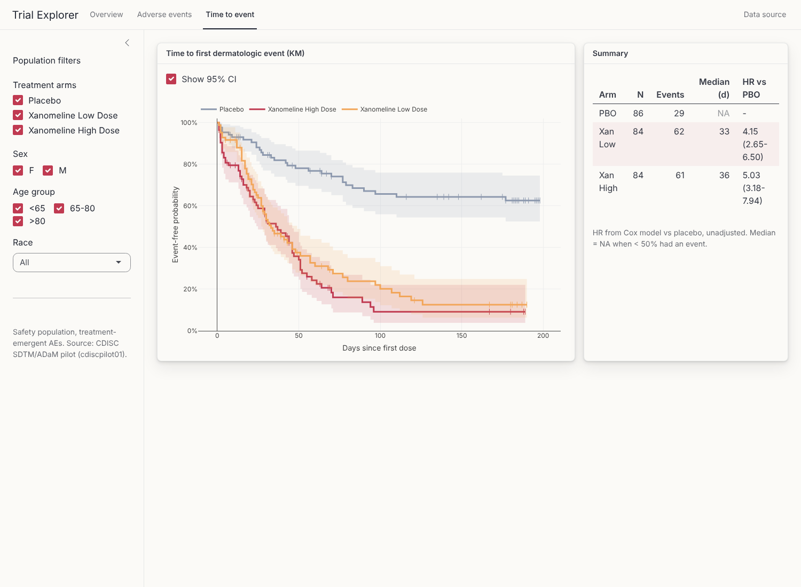

# Trial Explorer - interactive Shiny dashboard for clinical trial data

A small Shiny app for exploring a phase 2 trial in ADaM format: demographics, disposition, adverse events and time-to-event, with filters that apply across all tabs.

Data: the **CDISC SDTM/ADaM pilot** study (xanomeline transdermal patch vs placebo in mild to moderate Alzheimer's disease, 254 subjects in the safety population). The xpt files come from the [PHUSE scripts repo](https://github.com/phuse-org/phuse-scripts/tree/master/data/adam/cdiscpilot01). This is a public test dataset, not real patient data.

## What's in it

**Overview**: value boxes, a demographics table laid out like a TLF, age by arm (violin + points), and disposition as a 100% stacked bar.



**Adverse events** (treatment-emergent, safety pop):
- butterfly plot of the top N preferred terms, placebo vs the chosen xanomeline arm
- volcano plot: risk difference vs -log10 Fisher p for each PT, bubble size = number of subjects, hover for details
- heatmap of % subjects by system organ class x arm

You can filter by severity and change the comparison arm.



**Time to event**: KM curves for time to first dermatologic event (ADTTE, `PARAMCD == "TTDE"`) with censoring ticks and an optional CI, plus N / events / median / Cox HR vs placebo.



Both xanomeline doses have ~4-5x the hazard of a dermatologic AE vs placebo. That fits the AE tab, where application site pruritus/erythema dominate.

## Run it

```r
install.packages(c("shiny", "bslib", "plotly", "DT", "dplyr", "tidyr", "survival", "haven"))
# data/adam.rds is created from the xpt files on first run (R/prep_data.R)
shiny::runApp()
```

The xpt files are small enough to keep in `data/`. If they're missing, download `adsl.xpt`, `adae.xpt` and `adtte.xpt` from the PHUSE link above.

```
app.R            ui + server
R/helpers.R      demographics table, AE comparison (risk diff + Fisher), KM -> long df
R/prep_data.R    xpt -> rds, flags (SAFFL, TRTEMFL), recoding
```

## Notes

- AE incidence counts each subject once per PT (or SOC), denominators = filtered safety pop N per arm.
- Fisher p-values aren't adjusted for multiplicity. The volcano plot is for screening, not inference.
- The Google font (Inter) needs internet. Offline it just falls back to the system font.
- Ideas: a patient-level swimmer plot, lab shift tables from ADLBC, and download buttons for the tables.
